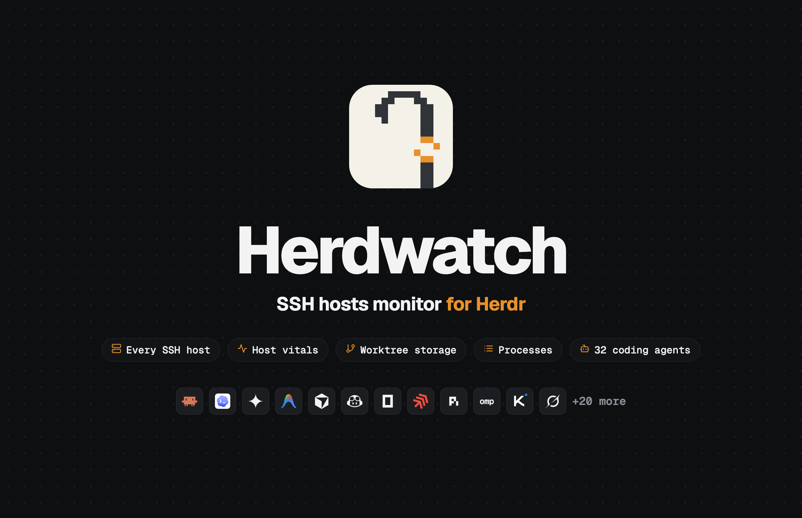
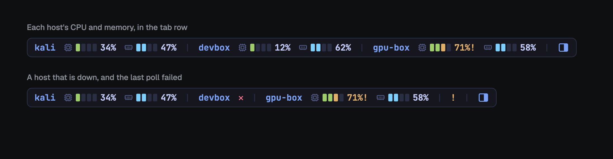
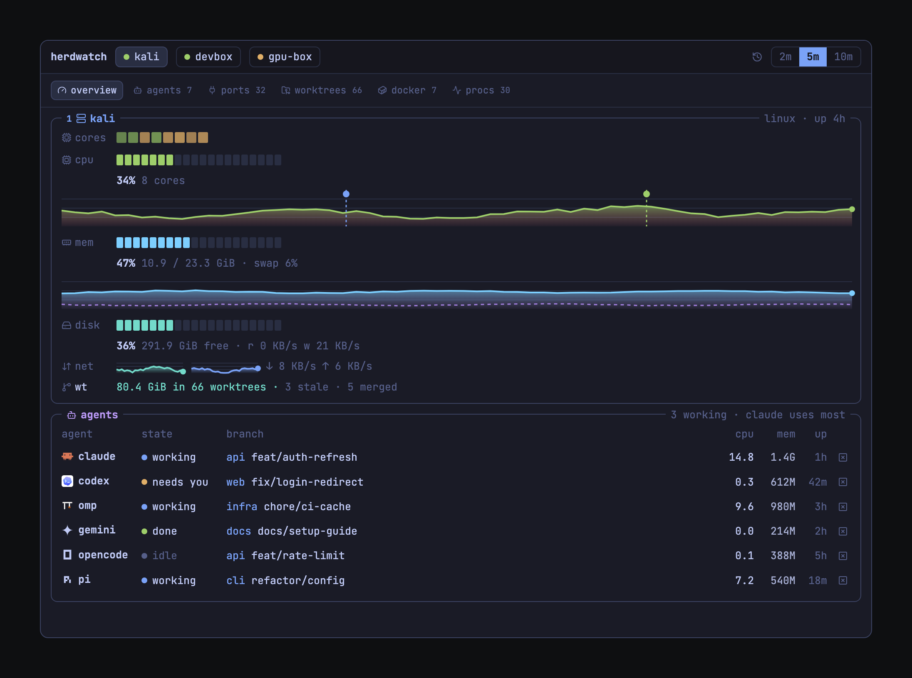
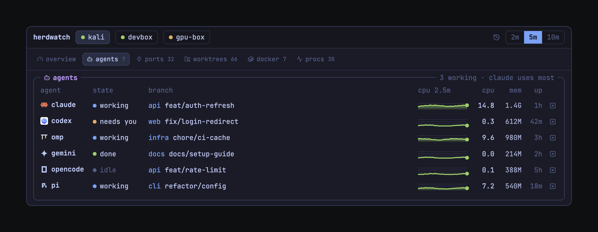
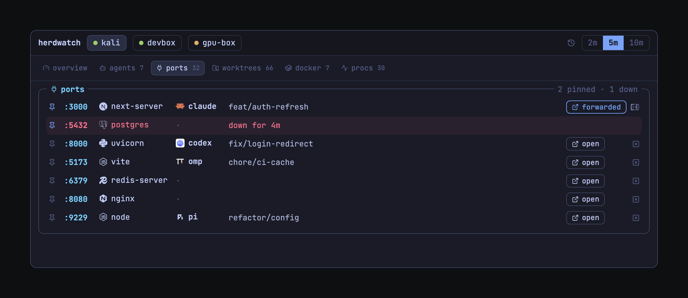
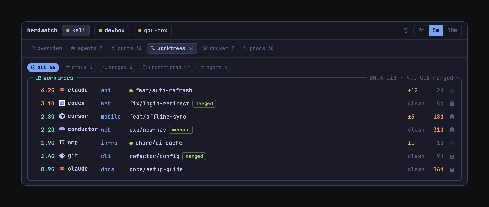
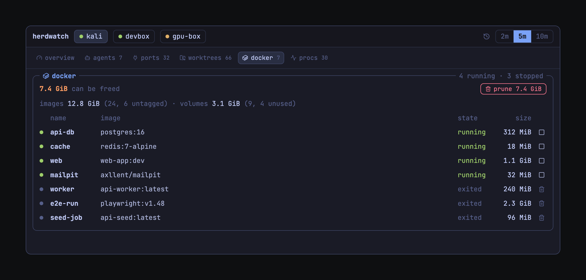
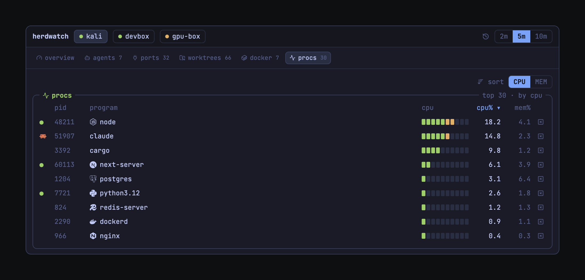
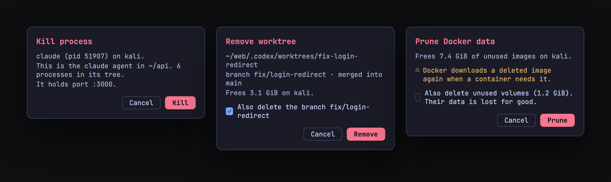
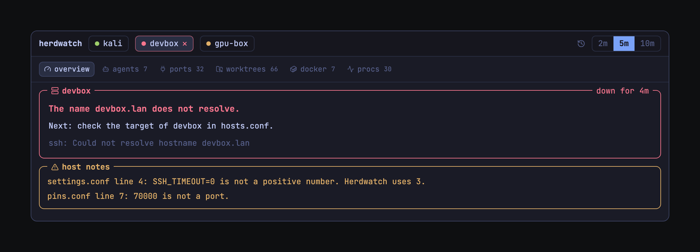

<p align="center"></p>

# Herdwatch

Your coding agents run on remote machines. From Herdr you cannot see if a host is out of memory, which agent waits for you, which dev server still holds a port, how much disk the old worktrees take, or what Docker keeps on the disk.

**Watch.** Herdwatch shows all of this for every SSH host, in one console inside [Herdr](https://herdr.dev). A pill in the tab row gives the CPU and memory of each host at a glance.

**Act.** Kill a process tree, pin a port and get an alert when it stops, open a remote port in your browser, delete a merged worktree, and stop, remove or prune Docker. Every action asks first.

**Know why.** When a host fails, Herdwatch tells you why and what to do. Your hosts need no daemon and no install: Herdwatch uses `ssh` and the tools that are already there.

It is a Herdr.app mod: JavaScript for the panel, Bash and POSIX `sh` for the polling.

## Install

Paste this into an agent that runs in Herdr:

```text
Read ~/.config/herdr-app/AGENTS.md, then add this mod: https://github.com/bryan-duarte/herdwatch/tree/main
```

Or install it by hand:

```bash
git clone https://github.com/bryan-duarte/herdwatch.git
```

```bash
cp -R herdwatch/mods/herdwatch ~/.config/herdr-app/mods/
```

Then add `"cmd-shift-m": "herdwatch.toggle"` to the `global` section of `~/.config/herdr-app/keys.json`.

Copy the folder; do not symlink it. Herdr does not reload a symlinked mod when its files change.

## Add your hosts

The first poll creates `~/.config/herdwatch/hosts.conf`. Add one host per line:

```text
# label     ssh target
devbox      me@devbox
gpu-box     ssh://me@10.0.0.7:2222
mini        mini            # an alias from ~/.ssh/config
```

- The label: letters, digits, `.`, `_` or `-`, at most 24 characters.
- The target: anything `ssh` accepts, but it must not start with `-`.
- Each host must accept a key login without a prompt. Test it first:

```bash
ssh -o BatchMode=yes me@devbox true
```

To watch the Mac or Linux box Herdr runs on, add `localhost`. This needs a running SSH server (on macOS: System Settings, Sharing, Remote Login).

## What you get

The pictures below use sample hosts and numbers.

### The pill



The compact view. On the first install, Herdr docks it as a thin strip at the top of the window. It shows each host's CPU and memory, each with its icon and a 4-cell meter, with `!` at 70% and `!!` at 90%. A down host shows `✕`, and a `!` after the hosts means the last poll failed (hover it to read why). Click the pill, or press `cmd-shift-m`, to open the console beside your terminal. The focus stays in your terminal. To put the pill in the tab row, see [Layout](#put-the-pill-in-the-tab-row).

### The console

It has one tab per host and six views. Keys (click the console first): `c` and `m` sort by CPU or memory, `1` to `4` choose a host. The range control switches the charts between 2, 5 and 10 minutes. Hover a host tab to see the SSH round-trip time.

**overview.** Per-core load, CPU and memory history charts with agent start and finish markers, disk use and I/O, network rates, GPU (NVIDIA), the worktree total and the agents on the host.



**agents.** Each coding agent session: app, state (`working`, `needs you`, `idle`, `done`), repository and branch, a CPU sparkline, and the CPU and memory of the agent's whole process tree. The title names the agent that uses the most.



**ports.** Listening TCP ports, and the agent that started each one (found through the parent processes). Pinned ports stay on top and show `down` when they stop. `open` forwards the port to your browser.



**worktrees.** Every git worktree with its size, uncommitted files and age, with filters for stale, merged, uncommitted, agent running and behind. A `merged` tag marks the ones you are done with. The tooltip gives the created date and the last git activity.



**docker.** Containers with their state and size, the images and volumes, and the space that a prune frees.



**procs.** The top 30 processes by CPU or memory. Agent processes are marked, and common programs (Node.js, Python, PostgreSQL, Redis, nginx, Docker and others) show their logo.



### Actions

Each action opens a dialog that says what it touches, and does nothing until you confirm (`Enter`) or cancel (`Esc`).



| Where | Button | What it does |
| --- | --- | --- |
| `agents`, `ports`, `procs` | kill | Sends TERM to the process and every process under it. If some stay alive, the dialog offers `Force kill` |
| `ports` | pin | Keeps the port on top. When it stops listening, you get one notification and a red `down` row |
| `ports` | open | Opens the port in your browser through an SSH tunnel on `127.0.0.1`. A second click on a forwarded port opens it again; stop closes the tunnel |
| `worktrees` | delete | Removes the worktree, and its branch if you tick the box. It warns about uncommitted files, and it refuses while an agent works there |
| `docker` | stop, remove | Stops a running container, or removes a stopped one |
| `docker` | prune | Deletes unused images. Unused volumes go only if you tick them, because their data is lost for good |

Herdwatch checks each action again on the host right before it runs, and it never touches the main checkout of a repository. The same actions work from a terminal: `bin/herdwatch action {pin|unpin|kill|worktree-remove|docker-stop|docker-rm|docker-prune} <label> [args]`.

### Clear errors

A host that fails shows the reason and the next step, for example `The name devbox.lan does not resolve. Check the target of devbox in hosts.conf.` A bad line in a config file shows the file, the line and the value that Herdwatch uses instead.



### Worktree storage

Every 5 minutes, Herdwatch finds the git linked worktrees under your home folder on each host and measures them with `du`. It reads git's own records, so it finds worktrees from any tool. The label comes from the folder:

| Folder | Label |
| --- | --- |
| `<repo>/.claude/worktrees/`, `.gemini/`, `.qwen/`, `.qoder/`, `.letta/` and any `<repo>/.<tool>/worktrees/` | the tool name |
| `~/.cursor/worktrees/` | `cursor` |
| `$CODEX_HOME/worktrees/` | `codex` |
| `~/.factory/worktrees/` | `droid` |
| `~/.omp/wt/` | `omp` |
| `~/conductor/workspaces/` | `conductor` |
| anything else | `git` |

## Agents it detects

Herdwatch finds agent processes by their command, by the script that `node`, `bun`, `deno` or `python3` runs, or by a native install in `<agent>/versions/<release>`. It knows 32 agents:

Claude Code (including Claude Desktop and remote sessions), Codex, Gemini CLI, Antigravity, Cursor Agent, GitHub Copilot CLI, OpenCode, Amp, Pi, PiG, omp, Crush, Goose, Factory Droid, Qwen Code, Kiro, Kimi Code, Cline, Auggie, Continue, Kilo Code, Grok, Devin, Letta Code, Hermes Agent, Qoder, Mastra Code, Jules, OpenHands, Plandex, Aider and DeepSeek Harness.

Each agent shows its own mark in the tables, the same mark as in Herdr's sidebar. An agent without a mark gets the Herdwatch pixel sheep. The sources and licenses of the marks are in [`icons/agents/LICENSES.md`](mods/herdwatch/icons/agents/LICENSES.md).

When Herdr already shows an agent in a pane on the same machine and folder, Herdwatch uses Herdr's state for it. Every other agent counts as `working` at 3% CPU or more, else `idle`.

Is your agent missing? Open an issue with the output of `ps -o comm=,args= -p <pid>` for its process.

## Settings

The first poll creates `~/.config/herdwatch/settings.conf` with every key commented out. Write `KEY=value`, one per line. Herdwatch reads this file as data and never sources it. It ignores a bad value and uses the default.

| Key | Default | What it does |
| --- | --- | --- |
| `WARN` | `70` | Percent for `!` in the pill and yellow in the console |
| `CRIT` | `90` | Percent for `!!`, red, and alerts |
| `ALERTS` | `on` | A Herdr notification and sound when a host stays at or above `CRIT` |
| `ALERT_POLLS` | `3` | Polls in a row at `CRIT` before an alert |
| `TOP_N` | `30` | Processes per host |
| `SSH_TIMEOUT` | `3` | Seconds before a poll of one host stops; keep it below 5 |
| `STALE_SECONDS` | `30` | Age after which values show `?` |
| `PANE_REFRESH` | `2` | Seconds between console redraws |
| `WORKTREE_ROOTS` | `~` | Folders to search on each host, separated by spaces, at most 8 |
| `WORKTREE_DEPTH` | `7` | Folder levels to search below each root |
| `WORKTREE_INTERVAL` | `300` | Seconds between worktree measures |
| `WORKTREE_TIMEOUT` | `120` | Seconds before the measure of one host stops |
| `MERGED_BRANCHES` | `main master develop trunk` | Branches that count for the `merged` tag; the default branch of `origin` is tried first |
| `DOCKER` | `on` | The Docker tab; `off` stops the Docker measure |
| `DOCKER_INTERVAL` | `300` | Seconds between Docker measures |
| `AGENT_PATTERN` | the agent commands, `node`, `bun`, `python` | Regex that marks agent processes in `procs` |

Pinned ports live in `~/.config/herdwatch/pins.conf`, one `<label> <port>` per line. The pin button writes this file for you.

## Put the pill in the tab row

Replace the tab-row block of your layout in `~/.config/herdr-app/layouts/<name>.json` with a row that holds both blocks:

```json
{ "type": "row", "children": [
  { "your tabs block": "unchanged" },
  { "id": "herdwatch-bar", "type": "block", "size": { "px": 340 },
    "content": { "mod": "herdwatch", "props": { "view": "bar" } } }
] }
```

Then remove the top strip from the layout. Keep one pill on screen: `cmd-shift-m` reaches only a pill that is shown. An open console keeps polling by itself if no pill is shown.

## What it runs on your machines

On the machine with Herdr:

- Every 5 s it runs `ssh` to each host, in parallel, with `BatchMode=yes` and one shared connection per host (`ControlMaster`). The connection closes 2 minutes after the last poll.
- It writes only to `~/.config/herdwatch/`, `~/.local/state/herdwatch/` (records and a log) and `/tmp/herdwatch-<uid>/` (SSH sockets and locks).

On each host:

- Every 5 s it runs a POSIX `sh` script over `ssh` stdin. The script uses `ps`, `top`, `df`, `ss` or `lsof`, `git rev-parse` and `/proc`. It takes about 1 s and writes only a temporary folder, which it deletes when it ends.
- Every 5 minutes it runs `find`, `du` and `git status` under `WORKTREE_ROOTS`. On large worktrees this is the heaviest part, so raise `WORKTREE_INTERVAL` if you need to.
- Every 5 minutes, if `docker` is there, it runs `docker info`, `docker ps -a`, `docker images` and `docker system df`.
- Only when you confirm an action, it runs a fixed script for that action: `kill`, `git worktree remove` and `git branch -d`, or `docker stop`, `docker rm` and `docker image prune` / `docker volume prune`. The values from the console go in as quoted arguments, and only if they match what the last poll saw.

Herdwatch sends no data anywhere else. An SSH tunnel for the open button listens on `127.0.0.1` only.

## Troubleshooting

| You see | It means | Do this |
| --- | --- | --- |
| `herdwatch: add hosts` | `hosts.conf` has no hosts | Add a host |
| `auth` on a host | SSH refused the key login | Run `ssh -o BatchMode=yes <target> true` and fix the key |
| `✕` on a host | The host did not answer | Hover the host, or open its tab: the console gives the reason and the next step |
| `!` in the pill | The last poll failed | Hover it to read why |
| A yellow line with a file and a line number | A bad value in `settings.conf`, `hosts.conf` or `pins.conf` | Fix that line; until then Herdwatch uses the value it names |
| `?` on a host | The values are older than `STALE_SECONDS` | The polls stopped: check `~/.local/state/herdwatch/herdwatch.log` |
| No worktrees | The first measure is still running, or `WORKTREE_ROOTS` is wrong | Wait 5 minutes, then check the roots |

After an update, run `herdr-app check ~/.config/herdr-app/mods/herdwatch` and `herdr-app status`.

## Uninstall

```bash
rm -rf ~/.config/herdr-app/mods/herdwatch ~/.config/herdwatch ~/.local/state/herdwatch /tmp/herdwatch-$(id -u)
```

Then remove the `herdwatch.toggle` key and the `herdwatch` block from your layout.

## Requirements

- Herdr.app on macOS or Linux, Bash 3.2 or later, and `ssh`.
- On each host: POSIX `sh`, `awk`, `ps`, `df` and `git`. Linux hosts also need `top` and `ss`; macOS hosts need `lsof`, `vm_stat` and `iostat`. `nvidia-smi` adds the GPU row.

## License

MIT. Agent logos belong to their owners; the ones in the images are the icons that Herdr ships.
