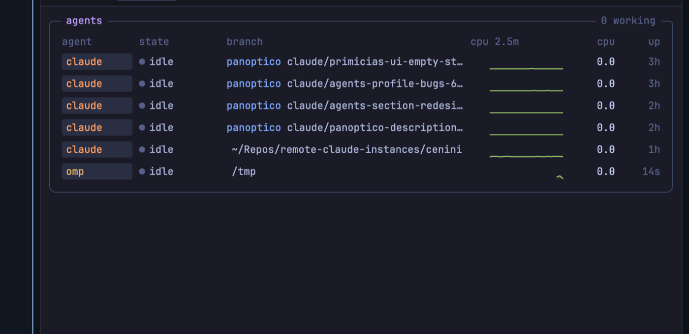

# Herdwatch - SSH server monitor for coding agents

Your coding agents run on remote servers, and from Herdr you cannot see when a host runs out of RAM or disk, which agent waits for you, or which dev server still holds a port. Herdwatch is an SSH system monitor for every server, VPS and homelab, a resource monitor like btop or htop in a side panel: CPU, memory, GPU, processes, Docker containers, ports, git worktrees and your Claude Code or Codex agents, with alerts and a kill button.

**Watch.** A pill in the tab row shows the CPU and memory of each host. One click opens the console: history charts, every agent with its state and the CPU and memory of its process tree, listening ports, worktree sizes, Docker and the top 30 processes.

**Act.** Kill a process tree, pin a port and get an alert when it stops, open a remote port in your browser, delete merged worktrees, and stop or prune Docker. Each action shows what it touches and asks first.

**Know why.** When a host fails, Herdwatch says why and what to do next. It uses only `ssh` and the tools that are already on the host: nothing to install.

## What you see

All colors are fixed Tokyo Night: background `#1a1b26`, dark `#16161e`, highlight `#292e42`, border `#3b4261`, comment `#565f89`, text `#c0caf5`, blue `#7aa2f7`, cyan `#7dcfff`, teal `#73daca`, green `#9ece6a`, yellow `#e0af68`, orange `#ff9e64`, red `#f7768e`, magenta `#bb9af7`, purple `#9d7cd8`. All text is JetBrains Mono.

**Interaction rule:** everything clickable has a frame or fill, a pointer cursor, a hover state (`#292e42`), a pressed state (`#3b4261`) and a tooltip. Nothing else reacts to hover.

- **Pill** (a 340 px layout block at the right of the tab row; on the first install, Herdr docks it as a 36 px strip at the top of the window): 28 px high, radius 7, `#16161e`, border `#292e42` (blue while the console is open or on hover). Per host: the label in bold blue, then two readings, CPU and memory: each its glyph (`cpu`, `memory-stick`), a 4-cell meter (CPU green to red, memory cyan to magenta) and the percent (yellow with `!` at WARN, red with `!!` at CRIT). Hosts split by `│`. Then `│` and a side-panel icon, filled blue while the console is open. `✕` for a down host, `auth` for a refused login, `…` before the first poll, `?` after stale values.
- **Console header** (40 px, `#16161e`): `herdwatch`, one tab per host with a health dot (green, yellow at WARN, red at CRIT or down) and a tooltip with the SSH round-trip time (or, for a host that fails, the reason), the range control `2m | 5m | 10m`, and a framed close button.
- **Tab strip**: `overview`, `agents N`, `ports N`, `worktrees N`, `docker N`, `procs 30`. The open tab is framed and filled.
- **Notices** (above the tab content): a backend failure, a late poll, or a bad line in a config file (`settings.conf line 4: SSH_TIMEOUT=0 is not a positive number. Herdwatch uses 3.`). A host that fails shows a panel with the reason, the next step and how long it is down (`dns`, `login`, `hostkey`, `refused`, `unreachable`, `timeout`, `tailscale_check`, `ssh_config`, `remote_shell`, `probe_format`).
- **overview**: a btop box titled `¹kali` with `linux · up 3h` in the top edge. Inside, top to bottom: `cores` (the number of cores); then CPU, a full-width block: its row (label, 20-cell meter) with the bold percent on a line under the meter, then its area chart (green to red with an end dot and markers for agent start, agent end and alerts), 46 px high, growing from the right. Then `mem` and `disk`, each a 20-cell meter with the bold percent and the detail under it and no chart: memory cyan to magenta with used / total GiB and swap; disk teal to red with the free space and the read and write rate. Then rows: `net` (two sparklines, down and up rate), `gpu` (when the host has an NVIDIA GPU; a meter with the numbers under it, as CPU), `wt` (worktree total, count, stale count). Below: the agents box, without the CPU sparklines: on the overview they cost more than the rest of the box. In a narrow pane the agents table shows the app mark and the state dot only, with smaller number columns, so the branch keeps its room.
- **agents**: one row per coding agent session: the agent's mark and name, state (`working` blue, `needs you` yellow, `idle` gray, `done` green), repository and branch (or the folder), a 2.5-minute CPU sparkline (wide panes), the CPU and memory of the agent's whole process tree (the tooltip names the programs in it), uptime and a kill button. The title says which agent uses the most.
- **ports**: listening TCP ports, pinned first, then agent-owned: a pin button, `:3000`, process (with its program mark), the agent that started it (found through the parent chain), that agent's worktree, an open button and a kill button. A pinned port that stops listening stays in the list in red as `down`. Open starts an SSH tunnel bound to `127.0.0.1` and opens the browser; the row then shows `forwarded` and a stop button. Ports of other users show `other user`.
- **worktrees**: filter chips with counts (`all`, `stale > 14d`, `merged`, `uncommitted`, `agent running`, `behind upstream`), the space reclaimable from stale worktrees, and a scroll list that fills the free height of the pane: size (teal to red by share of the largest), share meter, tool chip, repository, branch (`●` when an agent works there, a green `merged` tag when every commit is in a main branch and nothing is uncommitted), `±changed files` or `clean`, days since the last commit (orange when stale) and a delete button (off while an agent works there). The row tooltip gives the created date and the last git activity. The list draws the first 40 rows and a `show N more` button under them; another host or filter goes back to 40 rows.
- **docker**: the space that a prune frees and a prune button, a line with the images and volumes (size, count, untagged images, unused volumes), then the containers (running first: name, image, state, size, a stop or remove button). `DOCKER=off` hides the data; a host without Docker, or without access to its socket, says so.
- **procs**: a `CPU | MEM` sort control, then a table of the top 30: the agent's mark (or `●` for an agent run by node, bun or python), pid, program with its mark (Node.js, Next.js, Python, PostgreSQL, Redis, nginx, Docker and others; never the sheep), CPU meter (wide panes), `cpu%` and `mem%` headers that also sort, and a kill button.
- **Confirm dialog** (a modal Herdr overlay, 480 px): the title (red for a destructive action), what the action touches, the warnings in yellow (`3 files have uncommitted changes. They will be lost.`), check boxes for the options that do more (delete the branch too, delete unused volumes), and `Cancel` and the action button (`Enter` and `Esc` work). A failure stays in the dialog with its detail. A kill that leaves processes alive offers `Force kill`.
- **Footer**: `● agent │ [c] cpu [m] mem [1-4] host [⌘⇧M] toggle`, and `keys on` or `click the pane for keys`.
- **Agent marks**: each agent shows its own mark at 14 px, the way Herdr's sidebar draws it (a picture as it is, a one-color glyph in the text color). The marks of agents in Herdr's program table come from Herdr's `icons/` folder; the mod ships the others in `icons/agents/` (sources and licenses in `icons/agents/LICENSES.md`). An agent without a mark gets the Herdwatch pixel sheep in the agent's own accent color.
- **Navigation glyphs**: 12 px Lucide glyphs (ISC, in `icons/ui/`) in the text color of their control, one glyph per concept: `gauge` overview, `bot` agents, `plug` ports, `folder-git-2` worktrees, `activity` procs, `server` hosts, `cpu`, `memory-stick`, `hard-drive`, `arrow-down-up` network, `microchip` GPU, `git-branch`, `history` range, `arrow-down-wide-narrow` sort, `triangle-alert` notice, `keyboard` keys, `container` docker, `pin` pin, `external-link` open, `square` stop, `square-x` kill, `trash-2` delete, `check` check box, and `layers`, `archive`, `git-merge`, `file-diff`, `bot`, `arrow-down-to-line` on the worktree filters. In a pane narrower than 560 px, a tab that is not open shows only its glyph and count, and the agent columns show only the mark; the tooltips give the names.

## How it behaves

- One copy polls at a time: it runs `bin/herdwatch snapshot` every 5 s (one parallel SSH poll per host) and makes one shared write: `herdwatch.state` holds the snapshot without the worktree and Docker lists, the history (120 samples per host, 30 per agent, events) and the signatures of the lists. Each shared write redraws every Herdr mod, so a poll makes only one. `herdwatch.worktrees` is written only when a new measure arrives. The poller holds a 12 s lease in module memory: every copy shares the module, so the lease needs no shared write. When the pill is not shown, the console takes the lease, so its data stays fresh. Other copies only read, and they read the large lists again only when their signature changes. At its first start, a new version clears the shared keys of older versions once, after it moves the old history into `herdwatch.state`.
- When the snapshot says `worktrees_due`, the poller also runs `bin/herdwatch worktrees`; the backend measures every 5 minutes. `docker_due` runs `bin/herdwatch docker` in the same way, and the lists go to `herdwatch.docker`. Slow work never runs inside the 5 s poll.
- Actions: a button builds a pending action, stores it in `herdwatch.pending` and opens the confirm dialog. Confirm runs `bin/herdwatch action <name> <label> [args]`, which prints one JSON result. The backend checks every argument against the last stored records (a pid, a worktree path or a container id that Herdwatch did not see is refused), then sends a fixed script over SSH stdin with the values as quoted arguments, and checks again on the host right before it deletes. It refuses the main checkout of a repository and a worktree where an agent works.
- Pins live in `~/.config/herdwatch/pins.conf` (`<label> <port>`); the pin button rewrites the file and keeps its comments.
- First run: the backend copies `examples/hosts.conf` and `examples/settings.conf` to `~/.config/herdwatch/`. With no hosts, the pill shows `herdwatch: add hosts` and the console names the file to edit.
- Agent states come from Herdr.app's `agents()` when a Herdr agent on the same machine has the same app and folder; other agents are `working` from 3% CPU, else `idle`.
- Each console keeps its own host, tab, range, worktree filter and CPU/MEM sort.
- Redraws: the console is a cheap frame (header, tab strip, footer) around a retained `TabBody` view that draws the open tab (`tab-body.js`). Herdr redraws the frame on each change of its live data (agents, terminals, focus, shared state); the body is built again only when its body key changes: the tab and the other choices, the poll time, the list signatures, the clock key, Herdr's agent states and the tunnels. Clicks, tasks and the clock (every `PANE_REFRESH` seconds) compare the key and notify the body, because Herdr refuses a notify or `set_props` during render. So new data reaches the body at the next clock tick. A resize redraws only when the pane crosses the wide limit (560 px).
- Click handlers use the context of their own click (`onSelect(value, cx)`): a context kept from a render is stale by the time of the click.
- Render cost: QuickJS is an interpreter, so each render stays near 20 ms. The frame alone is about 400 host calls; a tab body is 1 500 to 5 000. Fixed answers are cached (gradient colors, program marks, the x positions of the charts), each chart builds its points once, and the worktree flags and filter counts come from one pass.
- Keys in the console (click it first): `c` and `m` sort, `1` to `4` choose a host. `cmd-shift-m` or a click on the pill opens and closes the console; the focus returns to your terminal.
- Alerts: ALERT_POLLS polls in a row at or above CRIT give one warning toast and the `blocked` sound, and a red marker on the CPU chart. A pinned port that stops listening gives one toast (`herdwatch: :3000 on devbox is down`).
- Errors: a failed SSH poll keeps a `reason` and a `detail` (the line of SSH's output that names the cause) and the time of the first failure. A failed backend run gives `backend_timeout`, `backend_missing`, `runtime_dir`, `bad_output` or `mod_bug`. The pill shows `!` with a tooltip when the last poll failed.

## Built from

- `mods/herdwatch/` (one mod; `props.view: "detail"` is the console, any other copy is the pill; `mod.json` is `{"place": "top", "size": 36, "title": "Herdwatch - SSH server monitor for coding agents", "focusable": true}`):
  - `main.js` (one view class for the pill and the console), `tab-body.js` (the retained view of the open tab's body), `poller.js` (the poll, alerts), `backend.js` (runs `bin/herdwatch` and checks its JSON), `store.js` (Herdr shared keys, the poll lease and saved console choices), `console-pane.js` (open, close, the confirm dialog overlay and the shortcut label), `snapshot.js`, `history.js`, `worktrees.js`, `docker.js`, `agents.js` (joins host processes with `agents()`), `actions.js` (runs `bin/herdwatch action`), `action-dialogs.js` (the dialog text of each action), `pending-action.js`, `tunnels.js` (SSH tunnels as `hc` background terminals), `failure-guidance.js` (the reason and next step of each failure), `agent-marks.js`, `program-marks.js`, `health.js`, `format.js`, `palette.js`, `schemas.js` (the data shapes). `views/`: `bar.js` (pill), `console.js` (the tabbed console), one `*-panel.js` file per tab, `confirm-dialog.js`, `charts.js` (`paint_path` area charts and sparklines) and `widgets.js` (btop box, meters, chips, keycaps, segmented control, tab strip, filter chips, icon, row and text buttons, check box).
  - `bin/herdwatch {snapshot|worktrees|docker|action}` and `lib/` (Bash 3.2 + POSIX awk): config with a problem list (`config.sh`, `problems.sh`), collector, locks (`lock.sh`), SSH with watchdogs, a detached ControlMaster per host and failure reasons (`ssh.sh`), records, rates from counters between polls, alerts, pins (`pins.sh`), Docker (`docker.sh`, `docker_probe.sh`), actions (`actions.sh` and the fixed remote scripts in `lib/action_scripts/`), JSON output.
  - `lib/probe/` (POSIX sh parts that the collector joins and sends over SSH stdin, about 1 s): CPU and per-core load, load, memory, swap, disk, disk and network counters, GPU via `nvidia-smi`, uptime, the top processes by CPU and by memory, agent sessions (35 agent commands, from Claude Code, Codex, Gemini, Copilot, Cursor and OpenCode to omp, Kimi, Qoder and Antigravity: the command name, the script of `node`/`bun`/`deno`/`python3.x`, or a native `<agent>/versions/<release>` install; named with Herdr's program table keys such as `cursor` and `kiro`; `cwd` from `/proc` or `lsof`; branch and repository from git), and listening ports (`ss` or `lsof`) with the owning agent.
  - `lib/worktrees_probe.sh`: git linked worktrees from git's own records, with size, changed files, ahead/behind, last commit, created date, last git activity and the first of `MERGED_BRANCHES` that holds every commit. The tool comes from the folder: `<repo>/.<tool>/worktrees/` (Claude, Gemini, Qwen, Qoder, Letta), `~/.cursor/worktrees`, `$CODEX_HOME/worktrees`, `~/.factory/worktrees` (Droid), `~/.omp/wt`, Conductor; else `git`.
- Charts: `PathBuilder.fill()` and `PathBuilder.stroke(w)` with percent coordinates, painted with `window.paint_path(path, Background.linear_gradient(...))` in an absolutely placed layer.
- Worktree list: a `v_flex()` with `overflow_y_scrollbar()` in a `flex_1().min_h(0)` box, rows `flex_none()`; the worktrees and docker tabs have no outer scroll.
- Layout: a `row` in place of the tab-row block: `[{the tabs block}, {"id": "herdwatch-bar", "type": "block", "size": {"px": 340}, "content": {"mod": "herdwatch", "props": {"view": "bar"}}}]`. `keys.json`: `"cmd-shift-m": "herdwatch.toggle"`.

## Watch out

- **It runs programs and reaches the network.** Every 5 s it runs `ssh` to each host in `~/.config/herdwatch/hosts.conf`; every 5 minutes it runs `find`, `du` and `git status` on each host, and `docker info`, `docker ps -a`, `docker images` and `docker system df` when Docker is on. Hosts need a key login without a prompt. Config files are data: never sourced; bad targets and bad worktree roots are refused.
- **It can kill and delete.** Never put a value from the UI into a remote command string. Send a fixed script on stdin and pass values as quoted arguments, only after they match a stored record. Docker ids must match `^[0-9a-f]{12,64}$`. Volumes are pruned only when the user ticks them.
- Shared state outlives a mod update. Validate it when you read it: an old history shape broke every poll until the reader started over with an empty history.
- The engine stops a render after about 55 ms. Run `npm run bench` before and after a change to the views: it counts the host calls in Node and times each tab in the real engine through `herdr-app check`. A tab case is the frame and that tab's body (a first visit); `frame` is the frame alone (a redraw that keeps the body). `npm run bench -- --against <git ref>` runs an A/B test.
- Make a retained view (`cx.new`) in `init`, an event handler or a task, and mount it only in a render. An entity that goes into an element built outside a render is released, and a later mount throws.
- In a mod pane, do not put `.on_mouse_down(stop_propagation)` on a clickable element: it cancels `on_click`. Never place clickable parts outside their parent with negative offsets.
- Rows of a list need `.w_full()`, or wide rows push the right columns out of view.
- Do not use `uniform_list`, `list` or `v_virtual_list` for rows with buttons: Herdr throws on `on_click` inside an item renderer, and the list then draws no rows.
- In POSIX `sh`, a tab in `IFS` is whitespace: two tabs in a row merge, so empty fields shift. Write a placeholder for empty fields.
- On macOS a program path can contain spaces (`Application Support`), so read it from `comm`, not from `args`.
- Install by copying `mods/herdwatch/` into `~/.config/herdr-app/mods/`; a symlink does not hot-reload.
- `<mod>.<command>` reaches shown copies only, so `cmd-shift-m` works while the pill is shown. Keep the pill in the layout; move the first-install strip into the tab row with the Layout entry above.
- Requirements on each host: POSIX `sh`, `awk`, `ps`, `df`, `git`; Linux also `top` and `ss`, macOS `lsof`, `vm_stat` and `iostat`. On this machine: Bash 3.2 or later and `ssh`.
- Background clicks do not reach the mod; test with the window in front. `herdr-app shot` returns the last rendered frame.

## Done when

- `herdr-app check ~/.config/herdr-app/mods/herdwatch` passes and `herdr-app status` shows no errors.
- The pill shows `kali ▮▯▯▯ n%`; a click opens the console and the focus stays in the terminal.
- Each tab opens with a click, and its count matches the rows; `2m`, `5m` and `10m` change the charts.
- `MEM`, the `mem%` header and the `m` key sort by memory; `c` sorts by CPU.
- With the console shown and no pill, the console takes the poll lease within 20 s, and then `herdwatch.state` is never older than 10 s.
- `npm run bench` shows one shared write per poll, and no tab passes the engine limit.
- A new agent session appears in `agents` within 5 s; its port appears in `ports` with the agent and worktree.
- The worktree list shows its rows, with the changed files, age and delete columns, in a narrow pane.
- A kill, a worktree delete and a Docker stop or prune each open the confirm dialog first; `Cancel` changes nothing.
- A pinned port that stops gives one toast and a red `down` row; a host with a bad name shows `The name ... does not resolve.` with a next step.
